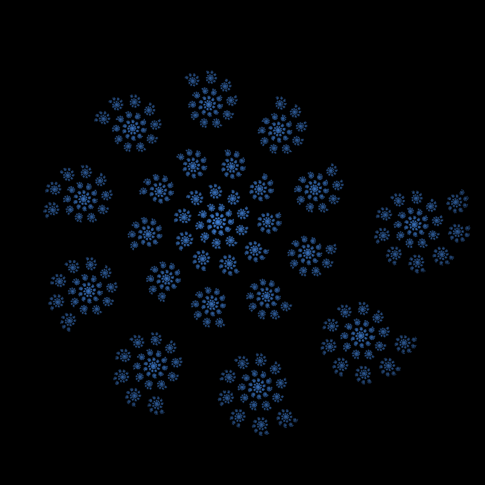
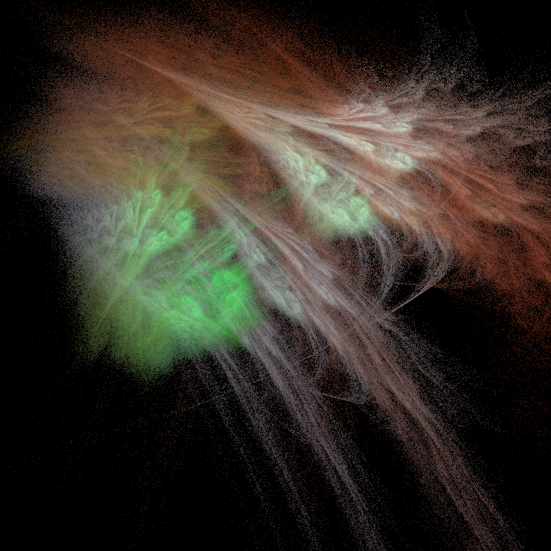

# IFS Collage Studio

An interactive **Iterated Function System (IFS)** fractal designer written in Julia using **Dear ImGui** (`CImGui.jl`) and **OpenGL**. 

Inspired by Barnsley's Collage Theorem, you sketch a seed shape freehand on the left canvas, spawn up to 13 coloured affine copies with non-linear quadratic bending, manipulate them with keyboard commands, and watch the resulting fractal attractor render in real time on the right.


---

## Gallery

<p align="center">
  
  
  <br>
  
  
</p>

## Installation & Running

1. Install [Julia](https://julialang.org) (v1.9 or newer recommended).
2. Open the Julia REPL and install the required packages with this one-liner:

```julia
using Pkg; Pkg.add(["CImGui", "ModernGL", "GLFW", "PNGFiles", "ColorTypes", "FixedPointNumbers"])
```

3. Run the application from your terminal:

```bash
julia IFSApp.jl
```

---

## How to Use

### 1. Draw Your Seed Shape
* Use the left mouse button to sketch a seed shape on the top-left canvas (adjust **Brush width** on the right of the canvas before locking).
* Press **Space** to lock your drawing and spawn **Map 1**.

### 2. Sculpt & Warp Maps
Press **Space** to add up to **13** coloured map copies, and use the keyboard to transform whichever map is currently highlighted:

| Shortcut | Action |
| :--- | :--- |
| **`Space`** | Lock seed drawing / Add a new map copy |
| **`Tab`** / **`Shift + Tab`** | Cycle forward / backward through active maps |
| **`Arrow Keys`** | Move selected map (`tx`, `ty`) |
| **`Cmd` (or `Ctrl`) + `Left / Right`** | Rotate selected map |
| **`Cmd` (or `Ctrl`) + `Up / Down`** | Uniformly scale selected map |
| **`Option` (or `Alt`) + `Arrows`** | Stretch or squash X / Y scale independently |
| **`Shift` + `Arrows`** | Shear horizontally (X) or vertically (Y) |
| **`Shift + Option` + `Arrows`** | Quadratic bend (`x²` and `y²` non-linear curvature) |
| **`F`** / **`G`** | Flip selected map horizontally / vertically |

### 3. Rendering, Framing & Saving
* **Probabilities:** Switch between **Equal** (`1/N` chance per map) and **Weighted** (proportional to map area).
* **Colour Modes:** Render in **W/B**, **Green**, **Red**, **Blue**, **Custom**, or **Map** (colour blending across branches).
* **Intensity:** Toggle logarithmic **Normalize** and histogram **Equalize** tone-mapping to bring out fine tendrils.
* **Framing:** Use **Out X/Y-Scale** and **Out X/Y-Offset** to zoom and pan the final fractal.
* **Max Idle Dots:** Automatically refines the render in batches whenever controls are idle, up to 5,000,000 iterations.
* **Save / Load IFS & PNG:** Save your complete collage (including your original hand-drawn seed, map colours, transforms, and render settings) as a human-readable `.toml` preset, or export the output canvas to `.png`.

## Authors

Vibe-coded - designed by Adam Ponting, co-developed with Gemini.
