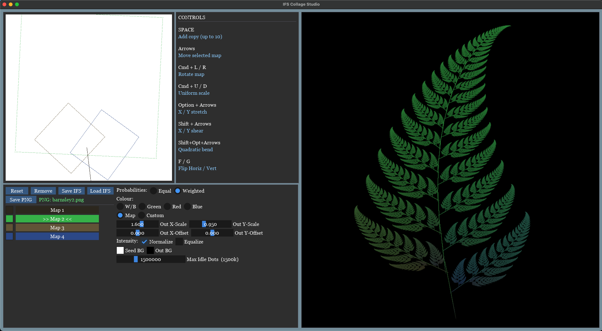
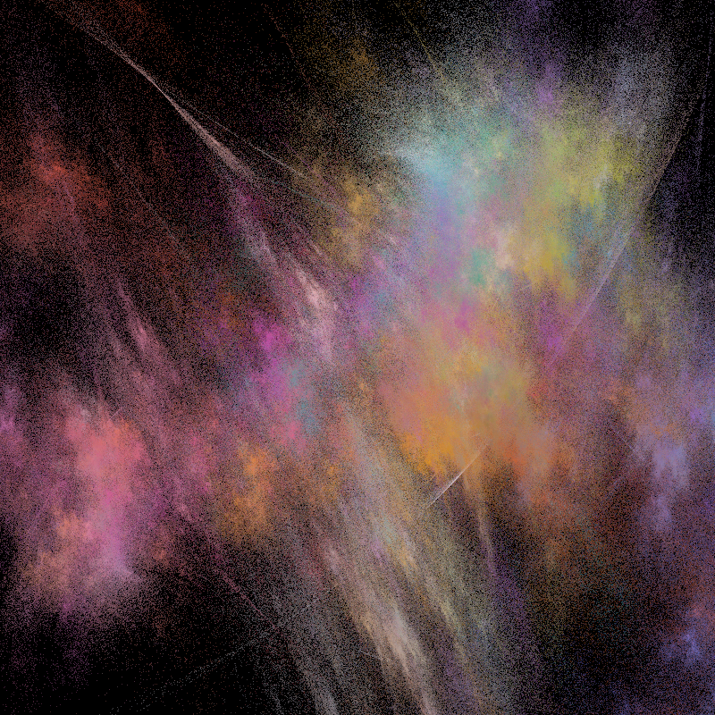
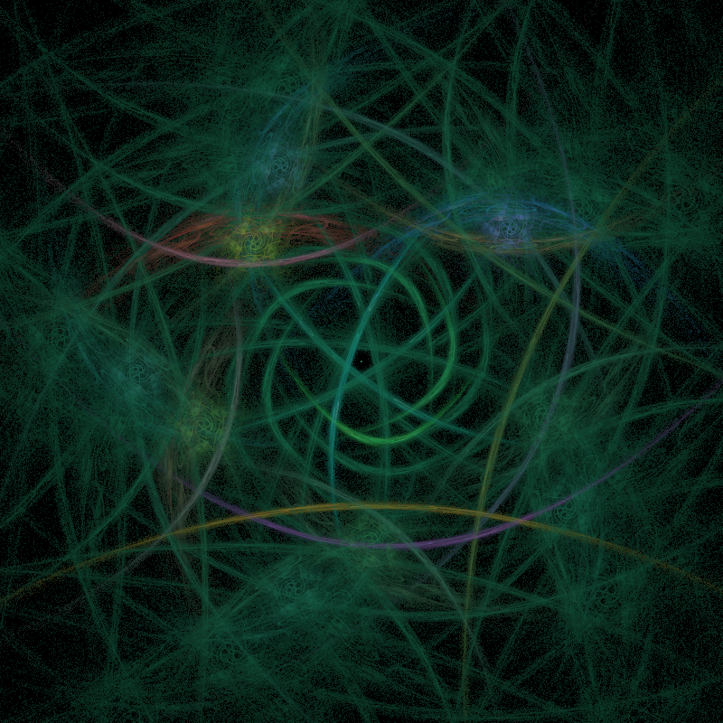

# IFS Collage Studio

An interactive **Iterated Function System (IFS)** fractal designer written in Julia using **Dear ImGui** (`CImGui.jl`) and **OpenGL**. 

Sketch a seed shape freehand on the left canvas, spawn coloured copies, manipulate them with keyboard commands, and watch the resulting fractal attractor render in real time. Inspired by Barnsley's Collage Theorem.



---

## Gallery

<p align="center">
  
  
  <br>
  
  
</p>

## Installation & Running

1. Install [Julia](https://julialang.org) (v1.9 or newer recommended).
2. Open the Julia REPL and install the required packages with this one-liner:

```julia
using Pkg; Pkg.add(["CImGui", "ModernGL", "GLFW", "PNGFiles", "ColorTypes", "FixedPointNumbers"])
```

3. Run the application from your terminal:

```bash
julia IFSApp.jl
```

---

## How to Use

### 1. Draw Your Seed Shape
* Click and drag to sketch a seed shape on the canvas 
* Press **Space** to spawn **Map 1**, a smaller copy of the seed shape.

### 2. Sculpt & Warp Maps
se the keyboard to manipulate and transform the currently highlighted map. Press **Space** to add more coloured map copies.

| Key combination | Action |
| :--- | :--- |
| **`Space`** | Lock seed drawing / Add a new map copy |
| **`Tab`** / **`Shift + Tab`** | Cycle forward / backward through active maps |
| **`Arrow Keys`** | Move selected map |
| **`Cmd` (or `Ctrl`) + `Left / Right`** | Rotate  |
| **`Cmd` (or `Ctrl`) + `Up / Down`** | Bigger / Smaller |
| **`Option` (or `Alt`) + `Arrows`** | Stretch or squash  |
| **`Shift` + `Arrows`** | Shear horizontally or vertically |
| **`Shift + Option` + `Arrows`** | Bend (`x²` and `y²` non-linear curvature) |
| **`F`** / **`G`** | Flip horizontally / vertically |

### 3. Rendering, Framing & Saving
* **Probabilities:** Switch between **Equal** (`1/N` chance per map) and **Weighted** (proportional to map area).
* **Colour Modes:** Render in **W/B**, **Green**, **Red**, **Blue**, **Custom**, or **Map** (colour blending across branches).
* **Intensity:** Toggle logarithmic **Normalize** and histogram **Equalize** tone-mapping to bring out fine tendrils.
* **Framing:** Use **Out X/Y-Scale** and **Out X/Y-Offset** to zoom and pan the final fractal.
* **Max Idle Dots:** Automatically refines the render in batches whenever controls are idle, up to 5,000,000 iterations.
* **Save / Load IFS & PNG:** Save your complete collage (including your original hand-drawn seed, map colours, transforms, and render settings) as a human-readable `.toml` file, or export the output image as a `.png`.

## Authors

Vibe-coded - designed by Adam Ponting, co-developed with Gemini.

## .toml File Format Reference

### 1. [settings] (Global Render Options)

- prob_mode (Integer): 1 = Equal probability per map, 2 = Weighted by map area (|sx * sy|).
- col_mode (Integer): 1 = White/Black, 2 = Green, 3 = Red, 4 = Blue, 5 = Custom colour, 6 = Map colour blending.
- custom_rgb, seed_bg, out_bg (3-element Float arrays): Red, green, and blue channels in [0.0, 1.0].
- out_sx, out_sy (Floats): Horizontal and vertical zoom/scale of the right-hand fractal output (typically 0.2 to 2.5).
- norm_on, eq_on (Booleans): true or false for logarithmic brightness normalization and histogram equalization.

### 2. [seed] (Left-Canvas Drawing)

- width, height (Integers): Dimensions of the saved seed grid (normally 530).
- pixels (List of [x, y] integer pairs): Every drawn pixel on the left canvas (1 to 530).
- Hand-writing tip: If you are writing a .toml file by hand, you can simply write pixels = [] (or omit the [seed] section entirely). The loader automatically falls back to drawing a border square on the left canvas so you can still see and edit your maps.

### 3. [[maps]] (One Block per Affine Transformation)

Repeat [[maps]] (with double square brackets) once for each map in your IFS:
- tx, ty (Floats): Horizontal and vertical translation in normalised canvas coordinates (-1.0 is left/top edge, 0.0 is centre, +1.0 is right/bottom edge).
- sx, sy (Floats): Horizontal and vertical scale factors (use negative values like -0.5 to flip/mirror).
- angle (Float): Rotation angle in radians (e.g., 1.5708 is 90°, 0.7854 is 45°).
- shx, shy (Floats): Horizontal and vertical shear factors (normally -1.5 to 1.5).
- bx, by (Floats): Quadratic bend coefficients added to the y² and x² terms (keep small, such as -0.2 to 0.2, so orbits stay bounded).
- rgb (3-element Float array): Display and blend colour [R, G, B] for that map in [0.0, 1.0].
